# Results

Generated by `scripts/evaluate.py` from the files in `results/`. Every number below is read from a result file; tables are also
written as CSV to `results/tables/`.

> **All data is synthetic.** These results show how the methods compare under the assumptions of the simulator
> (`docs/data_generator.md`). They are not estimates of detection performance on real trade data, and nothing here is a
> determination that a trade is laundering: the system flags trades for human review.

## 1. Summary

**Research question.** Can Federated Learning and Blockchain support privacy-preserving TBML detection across multiple organisations?

**Short answer.** Yes, with limits. Mean of 3 seeds, test period:

1. **Learning beats rules.** The rules engine reaches F1 0.431; pooled-data models reach 0.753 (MLP) and 0.806 (LightGBM).
2. **Federated learning works without moving raw data.** With 3 institutions and an IID split, FedAvg reaches F1 0.702, against 0.653 when each institution trains alone (+0.049). The server received model parameters and fixed-size aggregates only, which is enforced and tested.
3. **Parameter averaging costs almost nothing; fragmentation costs a lot.** One model trained on the pooled rows, but with each institution's locally computed indicators, reaches 0.698, the same level as FedAvg. Both are below the centralised MLP (0.753), because indicators that need to see related trades together (trade graph, shared bills of lading, entity history) are computed from one institution's records only.
   The typologies that lose most recall from centralised to federated are multiple invoicing (0.98 to 0.59) and circular trading (0.83 to 0.52).
4. **The thinner the data is spread, the more federating helps:** +0.049 F1 at 3 clients, +0.064 F1 at 5 clients, +0.109 F1 at 10 clients (IID).
5. **Under strong skew, local models win.** At Dirichlet α = 0.1, local-only reaches 0.801 and FedAvg 0.737: when a typology concentrates at one institution, its own graph is intact and its own threshold fits its own positive rate. Fine-tuning the global model locally closes the gap (0.804).
6. **Communication is small.** A model is 30.1 kB; a 30-round run with 3 clients moves 10.14 MB in total and reaches 95% of its final F1 after about 6 rounds.
7. **The evidence ledger is cheap enough to run alongside.** On the EVM backend a registration takes 8.9 ms (p50) / 10.6 ms (p95) and 103,088 gas; Merkle batching brings a trade document down to 206 gas. Tampering with an invoice, a model update or an alert is detected.
8. **Alerts are explainable and calibrated.** Precision is 31% / 59% / 96% in the Medium / High / Critical bands, and the suspected typology is right for 82% of alerts on illicit trades.

What this does not show: performance on real data, robustness against adaptive launderers, or behaviour of a real multi-node chain. See section 11.

## 2. Setup

| Seed | Trades | Illicit | Entities | Train (illicit) | Validation (illicit) | Test (illicit) |
| --- | ---: | ---: | ---: | ---: | ---: | ---: |
| 0 | 60,408 | 2,403 (3.98%) | 3,282 | 35,383 (4.0%) | 12,547 (4.2%) | 12,478 (3.6%) |
| 1 | 60,462 | 2,402 (3.97%) | 3,294 | 35,645 (4.3%) | 12,314 (3.7%) | 12,503 (3.4%) |
| 2 | 60,394 | 2,400 (3.97%) | 3,286 | 34,943 (3.7%) | 12,676 (4.7%) | 12,775 (3.9%) |

- **Split.** By invoice date: oldest 60% of the period for training, next 20% for validation, newest 20% for testing.
- **Threshold.** Every method's decision threshold maximises F1 on validation; test data never influences it.
- **Metrics.** Precision, recall, F1, PR-AUC (average precision), ROC-AUC, false-positive rate (FPR), confusion matrix, recall per typology.
  All methods are scored by the same histogram-based code, which is what a federation can compute without pooling predictions.
- **Seeds.** A seed fixes the data, the client split and the model initialisation. Tables give mean ± standard deviation over 3 seeds.
- **Local-only and fine-tuned models** use one threshold per client; their PR-AUC and ROC-AUC are for the merged ranking of all clients' scores.

## 3. Objective 1: risk indicators

81 indicators from invoice, shipment, payment and counterparty data (`docs/features.md`): 12 invoice, 22 shipment, 17 payment, 19 counterparty, 11 network.

Does each typology have an indicator that responds to it? The table lists, among the indicators designed for a typology (feature dictionary),
the ones that separate it best from legitimate trades: one-dimensional ROC-AUC of the single indicator, folded so that 0.5 is no signal and
1.0 is perfect, on the training period of seed 0.

| Typology | Strongest indicator | Separation | Next two |
| --- | --- | ---: | --- |
| over invoicing | `price_log_ratio` | 0.908 | `price_z` (0.90), `price_abs_z` (0.86) |
| under invoicing | `price_z` | 0.905 | `price_log_ratio` (0.90), `price_abs_z` (0.84) |
| multiple invoicing | `ship_qty_log_ratio` | 0.998 | `ship_qty_abs_dev` (1.00), `invoices_per_bl` (0.99) |
| phantom shipment | `missing_customs` | 0.916 | `days_payment_minus_ship` (0.84), `missing_both` (0.81) |
| over under shipment | `customs_qty_abs_dev` | 0.996 | `ship_qty_abs_dev` (0.99), `customs_qty_log_ratio` (0.54) |
| misdescription | `hs_mismatch` | 0.990 | `weight_per_unit_abs_dev` (0.92), `price_abs_z_declared_hs` (0.89) |
| third party payment | `payer_risk` | 0.994 | `third_party_payer` (0.98), `payer_country_differs` (0.97) |
| circular trading | `cycle_len_same_hs` | 0.964 | `edge_in_cycle_same_hs` (0.92), `days_invoice_to_payment` (0.88) |
| shell company | `min_party_age_log` | 0.867 | `exporter_n_trades_log` (0.79), `importer_hhi` (0.72) |
| high risk routing | `route_detour_ratio` | 0.976 | `route_max_stop_risk` (0.97), `n_transshipments` (0.95) |

A high separation does not mean high precision: most indicators are zero for almost all legitimate trades, and the few legitimate
trades that do trigger them still outnumber the illicit ones.

## 4. Objective 2: baselines (rules engine and centralised ML)

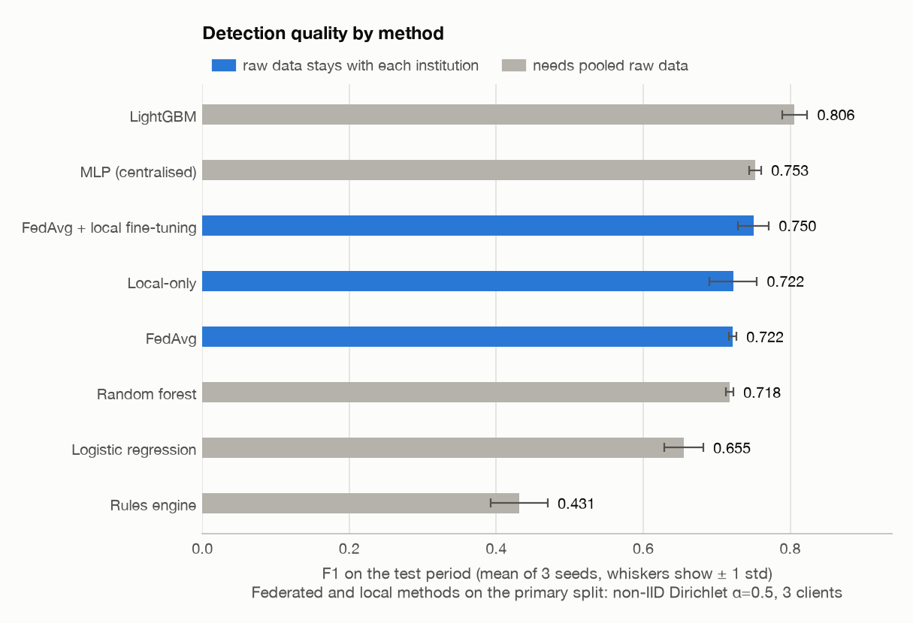

Pooled data, one party holds everything (the upper bound for a federation):

| Method | Precision | Recall | F1 | PR-AUC | ROC-AUC | FPR |
| --- | ---: | ---: | ---: | ---: | ---: | ---: |
| Rules engine | 0.325 ± 0.057 | 0.667 ± 0.044 | 0.431 ± 0.038 | 0.407 ± 0.043 | 0.878 ± 0.011 | 0.056 ± 0.018 |
| Logistic regression | 0.679 ± 0.050 | 0.634 ± 0.010 | 0.655 ± 0.026 | 0.694 ± 0.022 | 0.957 ± 0.005 | 0.012 ± 0.003 |
| Random forest | 0.793 ± 0.032 | 0.658 ± 0.028 | 0.718 ± 0.005 | 0.780 ± 0.010 | 0.971 ± 0.002 | 0.007 ± 0.001 |
| LightGBM | 0.876 ± 0.034 | 0.750 ± 0.051 | 0.806 ± 0.017 | 0.874 ± 0.009 | 0.981 ± 0.001 | 0.004 ± 0.001 |
| MLP (centralised) | 0.816 ± 0.055 | 0.705 ± 0.052 | 0.753 ± 0.008 | 0.820 ± 0.013 | 0.971 ± 0.002 | 0.006 ± 0.003 |

Rule book on the test period of seed 0 (pooled view). *Precision*: share of hits that are illicit. *Recall*: share of the rule's own
typology that it catches.

| Rule | Red flag | Typology | Hits | Precision | Recall |
| --- | --- | --- | ---: | ---: | ---: |
| R01 | Unit price far above reference | over invoicing | 66 | 29% | 28% |
| R02 | Unit price far below reference | under invoicing | 44 | 23% | 40% |
| R03 | Customs value differs from invoice value | over invoicing | 47 | 72% | 40% |
| R04 | Several invoices exceed one shipment | multiple invoicing | 48 | 100% | 100% |
| R05 | Paid, but no shipment and no customs record | phantom shipment | 38 | 63% | 52% |
| R06 | No customs record and paid early or near-empty shipment | phantom shipment | 17 | 82% | 30% |
| R07 | Shipped or declared quantity differs from invoice | over under shipment | 197 | 50% | 86% |
| R08 | Goods declared under a different HS heading | misdescription | 92 | 40% | 70% |
| R09 | Cargo weight inconsistent with the goods | misdescription | 80 | 52% | 60% |
| R10 | Unrelated third-party payer in a high-risk jurisdiction | third party payment | 28 | 36% | 17% |
| R11 | Unrelated third-party payer abroad | third party payment | 76 | 59% | 76% |
| R12 | Same goods traded round a loop | circular trading | 228 | 16% | 84% |
| R13 | Goods resold within days inside a loop | circular trading | 297 | 10% | 73% |
| R14 | Young company at a mass-registration address | shell company | 374 | 17% | 43% |
| R15 | Young company with very high turnover | shell company | 660 | 9% | 54% |
| R16 | Round amount paid in advance to or by a young company | shell company | 17 | 41% | 19% |
| R17 | Needless transshipment | high risk routing | 399 | 10% | 90% |
| R18 | Stop in a listed high-risk jurisdiction | high risk routing | 48 | 40% | 59% |
| R19 | Proceeds collected in an offshore bank | high risk routing | 162 | 20% | 45% |
| R20 | Party in a listed high-risk jurisdiction | high risk routing | 1298 | 2% | 10% |

At least one rule fires on 25.9% of trades; that set contains 88% of the illicit trades at 12% precision. Rules find most cases but bury them in false alerts.

## 5. Objective 3: federated learning

Horizontal FL with FedAvg on Flower. Each client is an institution that holds the complete linked records of its own trades and computes
its indicators from those records only (`docs/fl_design.md`).

### 5.1 Does federating help?

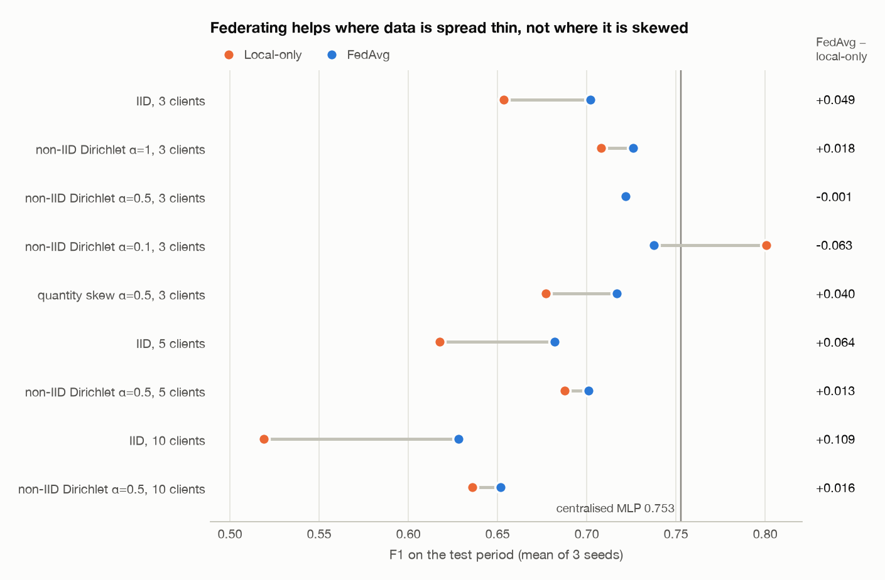

| Split | Clients | Largest / smallest client | Positive rate range | Local-only | Pooled model on local features (diagnostic) | FedAvg | FedAvg, client thresholds | FedAvg + local fine-tuning | FedProx |
| --- | ---: | ---: | ---: | ---: | ---: | ---: | ---: | ---: | ---: |
| IID | 3 | 1.0x | 3.8% - 4.1% | 0.653 ± 0.009 | 0.698 ± 0.003 | 0.702 ± 0.005 | 0.701 ± 0.005 | 0.696 ± 0.002 | - |
| Dirichlet α=1 | 3 | 2.5x | 2.4% - 6.6% | 0.708 ± 0.013 | 0.730 ± 0.009 | 0.726 ± 0.019 | 0.724 ± 0.019 | 0.735 ± 0.015 | 0.730 ± 0.023 |
| Dirichlet α=0.5 | 3 | 4.8x | 1.9% - 11.0% | 0.722 ± 0.032 | 0.736 ± 0.024 | 0.722 ± 0.005 | 0.733 ± 0.014 | 0.750 ± 0.021 | 0.710 ± 0.004 |
| Dirichlet α=0.1 | 3 | 3.3x | 2.3% - 7.4% | 0.801 ± 0.011 | 0.757 ± 0.012 | 0.737 ± 0.009 | 0.752 ± 0.014 | 0.804 ± 0.007 | 0.737 ± 0.007 |
| Quantity skew α=0.5 | 3 | 5.9x | 3.8% - 4.2% | 0.677 ± 0.013 | 0.713 ± 0.008 | 0.717 ± 0.006 | 0.715 ± 0.004 | 0.711 ± 0.007 | 0.720 ± 0.003 |
| IID | 5 | 1.0x | 3.7% - 4.1% | 0.618 ± 0.005 | 0.693 ± 0.010 | 0.682 ± 0.008 | 0.673 ± 0.003 | 0.676 ± 0.003 | - |
| Dirichlet α=0.5 | 5 | 4.4x | 1.6% - 9.7% | 0.688 ± 0.027 | 0.714 ± 0.015 | 0.701 ± 0.006 | 0.702 ± 0.012 | 0.734 ± 0.014 | - |
| IID | 10 | 1.0x | 3.7% - 4.3% | 0.519 ± 0.015 | 0.654 ± 0.007 | 0.628 ± 0.005 | 0.622 ± 0.003 | 0.622 ± 0.006 | - |
| Dirichlet α=0.5 | 10 | 10.3x | 1.0% - 16.2% | 0.636 ± 0.024 | 0.673 ± 0.015 | 0.652 ± 0.021 | 0.663 ± 0.008 | 0.683 ± 0.018 | - |

F1, mean ± std. *Pooled model on local features* is a diagnostic, not a deployable method: it pools rows but uses each client's locally
computed indicators, so the gap from the centralised MLP to it is what information fragmentation costs, and the gap from it to FedAvg is
what training by parameter averaging costs. *Client thresholds*: same global model, each client picks its own threshold.
*Local fine-tuning*: each client adapts the global model to its own data after training, without sending anything.

### 5.2 Detection metrics of the federated and local methods

| Method | Data | Precision | Recall | F1 | PR-AUC | ROC-AUC | FPR |
| --- | --- | ---: | ---: | ---: | ---: | ---: | ---: |
| Local-only | IID, 3 clients | 0.765 ± 0.011 | 0.571 ± 0.015 | 0.653 ± 0.009 | 0.699 ± 0.004 | 0.942 ± 0.004 | 0.007 ± 0.001 |
| Pooled model on local features (diagnostic) | IID, 3 clients | 0.778 ± 0.030 | 0.635 ± 0.015 | 0.698 ± 0.003 | 0.754 ± 0.004 | 0.954 ± 0.005 | 0.007 ± 0.001 |
| FedAvg | IID, 3 clients | 0.734 ± 0.019 | 0.674 ± 0.009 | 0.702 ± 0.005 | 0.755 ± 0.002 | 0.956 ± 0.006 | 0.009 ± 0.001 |
| FedAvg, client thresholds | IID, 3 clients | 0.754 ± 0.025 | 0.655 ± 0.013 | 0.701 ± 0.005 | 0.755 ± 0.002 | 0.956 ± 0.006 | 0.008 ± 0.001 |
| FedAvg + local fine-tuning | IID, 3 clients | 0.736 ± 0.003 | 0.661 ± 0.005 | 0.696 ± 0.002 | 0.752 ± 0.000 | 0.955 ± 0.006 | 0.009 ± 0.001 |
| Local-only | non-IID Dirichlet α=0.5, 3 clients | 0.752 ± 0.047 | 0.696 ± 0.028 | 0.722 ± 0.032 | 0.761 ± 0.029 | 0.950 ± 0.009 | 0.009 ± 0.002 |
| Pooled model on local features (diagnostic) | non-IID Dirichlet α=0.5, 3 clients | 0.823 ± 0.015 | 0.667 ± 0.036 | 0.736 ± 0.024 | 0.791 ± 0.028 | 0.963 ± 0.006 | 0.005 ± 0.001 |
| FedAvg | non-IID Dirichlet α=0.5, 3 clients | 0.784 ± 0.033 | 0.670 ± 0.018 | 0.722 ± 0.005 | 0.772 ± 0.007 | 0.960 ± 0.003 | 0.007 ± 0.002 |
| FedAvg, client thresholds | non-IID Dirichlet α=0.5, 3 clients | 0.815 ± 0.036 | 0.667 ± 0.003 | 0.733 ± 0.014 | 0.772 ± 0.007 | 0.960 ± 0.003 | 0.006 ± 0.002 |
| FedAvg + local fine-tuning | non-IID Dirichlet α=0.5, 3 clients | 0.813 ± 0.029 | 0.696 ± 0.021 | 0.750 ± 0.021 | 0.801 ± 0.017 | 0.965 ± 0.003 | 0.006 ± 0.001 |
| FedProx | non-IID Dirichlet α=0.5, 3 clients | 0.769 ± 0.066 | 0.668 ± 0.049 | 0.710 ± 0.004 | 0.772 ± 0.006 | 0.961 ± 0.003 | 0.008 ± 0.003 |
| Local-only | non-IID Dirichlet α=0.1, 3 clients | 0.865 ± 0.014 | 0.745 ± 0.017 | 0.801 ± 0.011 | 0.857 ± 0.016 | 0.974 ± 0.008 | 0.004 ± 0.000 |
| Pooled model on local features (diagnostic) | non-IID Dirichlet α=0.1, 3 clients | 0.798 ± 0.015 | 0.721 ± 0.022 | 0.757 ± 0.012 | 0.816 ± 0.008 | 0.968 ± 0.001 | 0.007 ± 0.001 |
| FedAvg | non-IID Dirichlet α=0.1, 3 clients | 0.779 ± 0.028 | 0.702 ± 0.029 | 0.737 ± 0.009 | 0.800 ± 0.006 | 0.964 ± 0.003 | 0.008 ± 0.001 |
| FedAvg, client thresholds | non-IID Dirichlet α=0.1, 3 clients | 0.787 ± 0.025 | 0.721 ± 0.016 | 0.752 ± 0.014 | 0.800 ± 0.006 | 0.964 ± 0.003 | 0.007 ± 0.002 |
| FedAvg + local fine-tuning | non-IID Dirichlet α=0.1, 3 clients | 0.841 ± 0.027 | 0.771 ± 0.014 | 0.804 ± 0.007 | 0.862 ± 0.007 | 0.976 ± 0.004 | 0.006 ± 0.001 |
| FedProx | non-IID Dirichlet α=0.1, 3 clients | 0.781 ± 0.017 | 0.698 ± 0.001 | 0.737 ± 0.007 | 0.799 ± 0.008 | 0.964 ± 0.002 | 0.007 ± 0.001 |

### 5.3 F1 by round

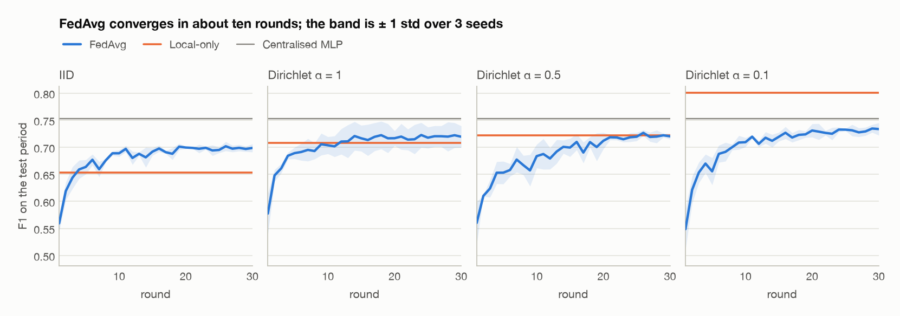

### 5.4 F1 against data skew (Dirichlet α)

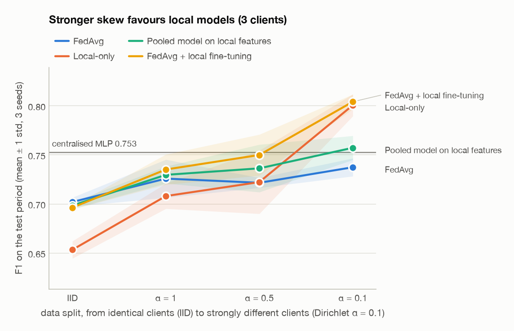

FedProx (μ = 0.01) against FedAvg: α = 0.1: 0.737 vs 0.737; α = 0.5: 0.710 vs 0.722; α = 1: 0.730 vs 0.726. FedProx does not improve on FedAvg at any α: the differences range from -0.011 to +0.004 F1, small against the spread between seeds.

### 5.5 F1 against the number of clients

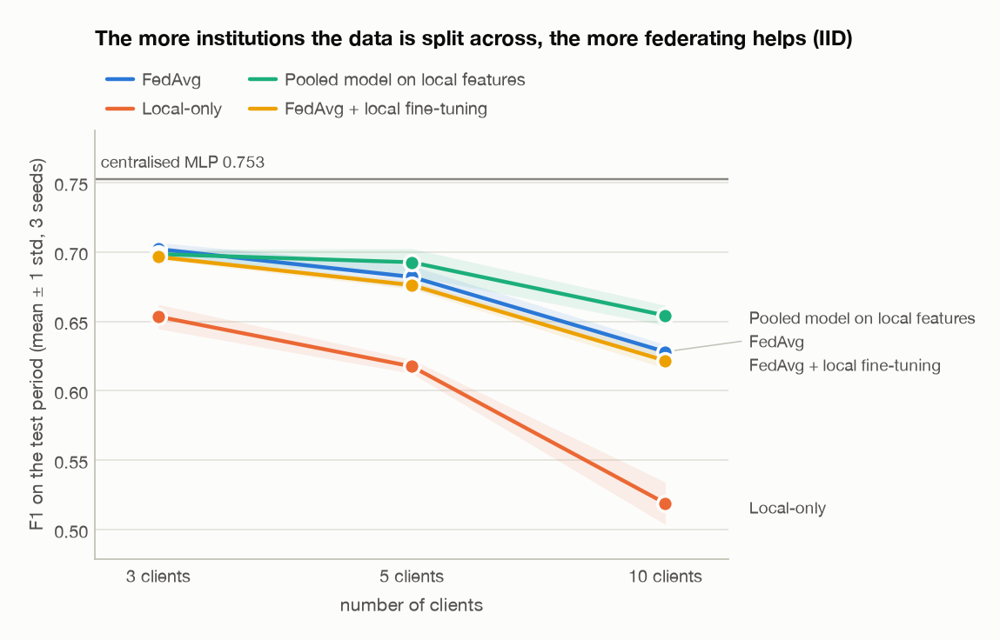

### 5.6 Which laundering patterns each method catches

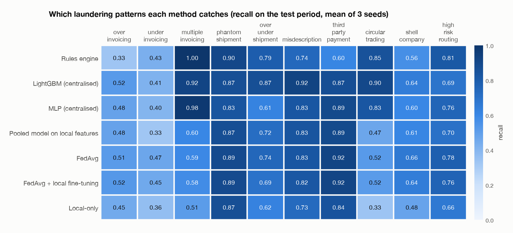

Recall per typology, IID, 3 clients, mean of 3 seeds:

| Method | over invoicing | under invoicing | multiple invoicing | phantom shipment | over under shipment | misdescription | third party payment | circular trading | shell company | high risk routing |
| --- | ---: | ---: | ---: | ---: | ---: | ---: | ---: | ---: | ---: | ---: |
| Rules engine | 0.33 | 0.43 | 1.00 | 0.90 | 0.79 | 0.74 | 0.60 | 0.85 | 0.56 | 0.81 |
| LightGBM (centralised) | 0.52 | 0.41 | 0.92 | 0.87 | 0.87 | 0.92 | 0.87 | 0.90 | 0.64 | 0.69 |
| MLP (centralised) | 0.48 | 0.40 | 0.98 | 0.83 | 0.61 | 0.83 | 0.89 | 0.83 | 0.60 | 0.76 |
| Pooled model on local features | 0.48 | 0.33 | 0.60 | 0.87 | 0.72 | 0.83 | 0.89 | 0.47 | 0.61 | 0.70 |
| FedAvg | 0.51 | 0.47 | 0.59 | 0.89 | 0.74 | 0.83 | 0.92 | 0.52 | 0.66 | 0.78 |
| FedAvg + local fine-tuning | 0.52 | 0.45 | 0.58 | 0.89 | 0.69 | 0.82 | 0.92 | 0.52 | 0.64 | 0.76 |
| Local-only | 0.45 | 0.36 | 0.51 | 0.87 | 0.62 | 0.73 | 0.84 | 0.33 | 0.48 | 0.66 |

### 5.7 Raw data stays local

Every reply that reached the server in the primary run was checked against a whitelist before use: 183 replies (3 feature-statistics, 90 training, 90 evaluation), 0 violations, 0 arrays outside training replies. The largest training reply was 31.7 kB for a 30.1 kB model: its size is fixed by the model, not by the client's data. Twelve ways of smuggling rows into a reply are rejected in `tests/test_fl.py`.

## 6. Communication overhead

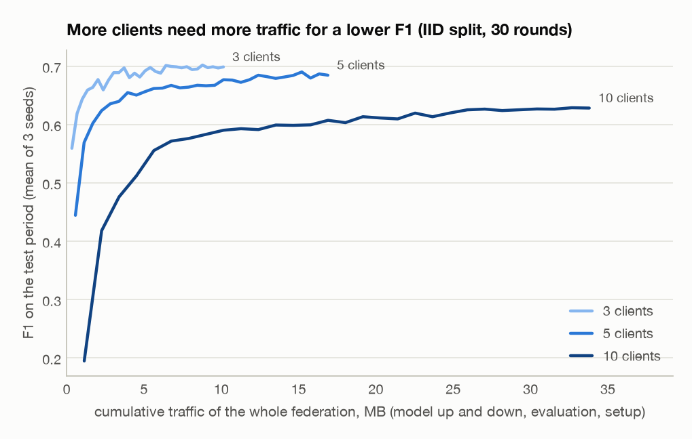

| Clients (IID) | Model | Train: down / up per client per round | Evaluate: down / up per client per round | All clients per round | Whole run (30 rounds) | To reach 90% of centralised F1 | To converge (95% of own best F1) |
| ---: | ---: | ---: | ---: | ---: | ---: | ---: | ---: |
| 3 | 30.1 kB | 31.6 kB / 31.7 kB | 31.6 kB / 17.7 kB | 0.34 MB | 10.14 MB | 8 rounds, 2.71 MB (3 of 3 seeds) | 6 rounds, 2.14 MB |
| 5 | 30.1 kB | 31.6 kB / 31.7 kB | 31.6 kB / 17.7 kB | 0.56 MB | 16.90 MB | 18 rounds, 10.14 MB (3 of 3 seeds) | 9 rounds, 5.26 MB |
| 10 | 30.1 kB | 31.6 kB / 31.7 kB | 31.6 kB / 17.7 kB | 1.13 MB | 33.80 MB | not reached (0 of 3 seeds) | 12 rounds, 13.53 MB |

Bytes are the serialised (protobuf) size of every message. An evaluation reply carries two score histograms, not predictions.
The 90% target is 0.90 x the centralised MLP's F1 for the same seed.

## 7. Objective 4: blockchain evidence layer

| Measure | EVM (Hardhat node) | Pure Python |
| --- | ---: | ---: |
| Single registration, latency p50 / p95 | 8.9 / 10.6 ms | 2.9 / 3.2 ms |
| Single registration, throughput | 100 records/s | 343 records/s |
| Cost per record, single | 103,088 gas | 573 bytes appended |
| Batch of 10: throughput | 579 records/s | 1,784 records/s |
| Batch of 50: throughput | 1,706 records/s | 6,965 records/s |
| Batch of 100: throughput | 1,960 records/s | 9,857 records/s |
| Cost per record in the largest batch | 74,209 gas | 105 bytes appended |
| Merkle root per batch of documents: throughput | 46,506 documents/s | 92,085 documents/s |
| Cost per document with Merkle batching | 206.2 gas | 1.2 bytes appended |
| Ledger storage per record | 96 bytes | 106 bytes |
| Ledger storage per document with Merkle batching | 0.19 bytes | 1.16 bytes |
| Read (`verify`) latency p50 | 2.68 ms | < 0.01 ms |

With blocks mined every 1 s (how a real permissioned chain behaves) one registration takes 1.0 s, and 100 registrations submitted together are all final after 1.1 s in 1 block. Latency is then set by the block interval, not by the contract.

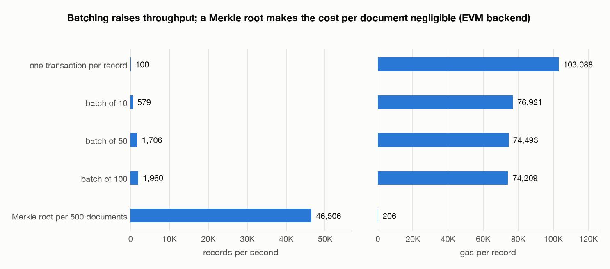

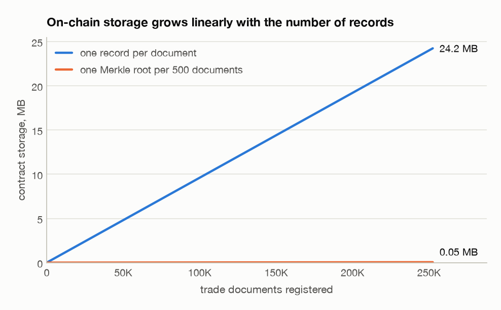

The storage lines are the measured bytes per record (contract storage slots; state-trie overhead excluded) multiplied by the number of documents.

What the pipeline registered (primary seed):

| Evidence | Volume | Time | Cost |
| --- | --- | ---: | ---: |
| Trade documents at ingestion | 252,546 documents in 508 Merkle batches | 11.5 s | 208 gas per document |
| Model hashes of the primary FL run | 90 client updates + 30 global models | 17 ms p50 each | 142,566 gas each |
| Alerts | 426 alerts | 15 ms p50 each | 103,030 gas each |

Integrity verification demo (`scripts/ledger_tamper_demo.py`, evm backend):

| Case | Result |
| --- | --- |
| Invoice as registered | verified |
| Invoice value changed from 107,043.44 to 117,747.78 | rejected |
| Same, and the off-chain index rewritten to match | rejected |
| Global model of round 29 | verified |
| One weight changed by 0.001 | rejected |
| Alert as raised | verified |
| Alert with its score lowered afterwards | rejected |

Only hashes, document types, opaque reference ids and timestamps are on the ledger. Design and limitations: `docs/ledger.md`.

## 8. Objective 5: explainable risk scores

`risk = 100 x C(0.7 x P_model + 0.3 x P_rules)`, every part calibrated on validation histograms (`docs/scoring.md`). Primary run, test period:

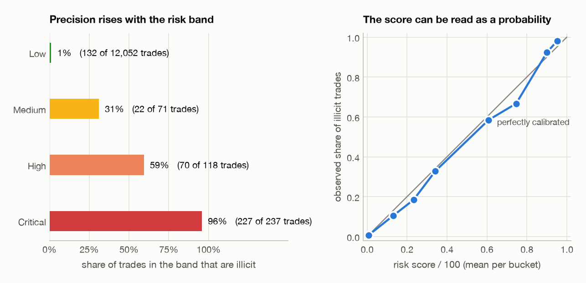

| Band | Score | Trades | Illicit | Precision | Share of all illicit trades |
| --- | --- | ---: | ---: | ---: | ---: |
| Low | 0 - 25 | 12,052 | 132 | 1.1% | 29.3% |
| Medium | 25 - 50 | 71 | 22 | 31.0% | 4.9% |
| High | 50 - 75 | 118 | 70 | 59.3% | 15.5% |
| Critical | 75 - 100 | 237 | 227 | 95.8% | 50.3% |

| Score | F1 | Precision | Recall | PR-AUC | FPR |
| --- | ---: | ---: | ---: | ---: | ---: |
| Risk score (blend) | 0.745 | 0.833 | 0.674 | 0.770 | 0.51% |
| Global model alone | 0.726 | 0.774 | 0.683 | 0.782 | 0.75% |
| Rules alone (local indicators) | 0.349 | 0.244 | 0.610 | 0.288 | 7.07% |

- **Calibration.** Expected calibration error 0.0106 for the model as trained, 0.0025 for the risk score; Brier score 0.0163 against 0.0141.
- **Blend weight.** Fixed at 0.7 in advance; the best value on validation is 0.8. The sweep is in `docs/scoring.md`.
- **Alerts.** 426 alerts, 75% on truly illicit trades. Each lists its top SHAP contributions in plain English, the rules that fired, a suspected typology, and its hash and transaction id. A readable sample is in `results/alerts/report.md`.
- **Suspected typology** is right for 82% of alerts on illicit trades and within the top two for 96%.
- **Rule floor.** 2 alert(s) were raised only because of the rule floor; 0 of them on illicit trades.
- **SHAP.** Method: permutation; additivity error 9.5e-07.

## 9. Stretch goals

### 9.1 Secure aggregation (pairwise additive masking)

Clients send their weighted updates as fixed-point 64-bit integers with pairwise masks that cancel in the sum. After one round the aggregated model differs from plain FedAvg by at most 1.2e-07 per weight, with the same confusion matrix. Over the full run rounding differences are amplified by training: F1 0.730 against 0.726. The upload is 1.95x larger. The server sees only masked arrays. Not handled: a client that drops out mid-round (the masks then do not cancel).

### 9.2 Differential privacy (DP-SGD with Opacus)

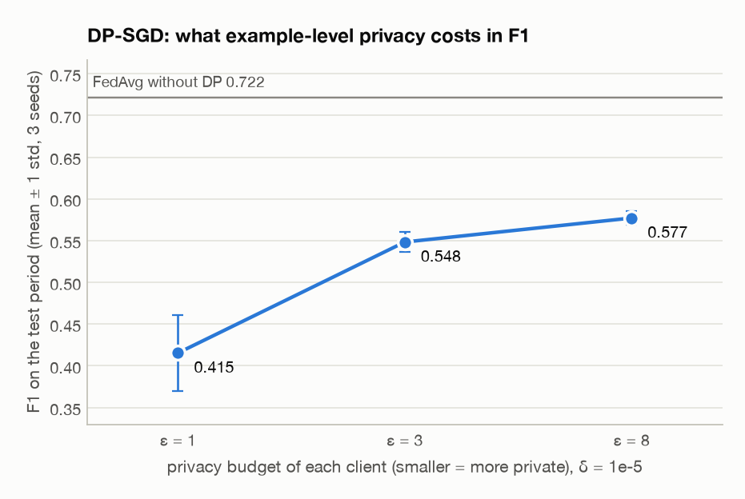

| Privacy budget per client | Mean noise multiplier | F1 | PR-AUC |
| --- | ---: | ---: | ---: |
| no DP | - | 0.722 ± 0.005 | 0.772 ± 0.007 |
| ε = 8 | 0.94 | 0.577 ± 0.008 | 0.605 ± 0.017 |
| ε = 3 | 1.68 | 0.548 ± 0.012 | 0.570 ± 0.019 |
| ε = 1 | 4.10 | 0.415 ± 0.046 | 0.395 ± 0.050 |

Example-level (ε, δ = 1e-05)-DP for each client's own training rows, clipping norm 2, accounted with Rényi DP over all local steps of the run. Smaller clients need more noise for the same budget. The clipping norm was chosen on validation at ε = 3 on one seed (12 combinations of clipping norm, batch size and learning rate); an untuned setting was clearly worse.

### 9.3 Model poisoning and norm clipping

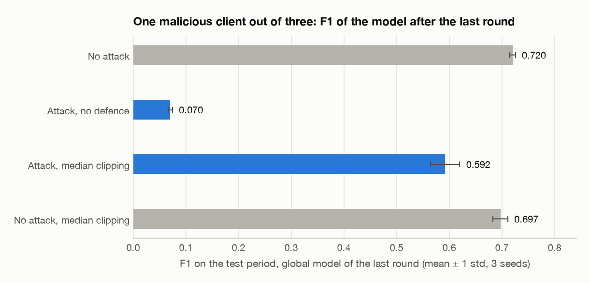

| Condition | F1, model of the last round | F1, round selected on validation | Selected round |
| --- | ---: | ---: | ---: |
| No attack | 0.720 ± 0.005 | 0.722 ± 0.005 | 27 |
| Attack, no defence | 0.070 ± 0.004 | 0.372 ± 0.120 | 1 |
| Attack, median norm clipping | 0.592 ± 0.028 | 0.584 ± 0.038 | 16 |
| No attack, median norm clipping | 0.697 ± 0.014 | 0.700 ± 0.020 | 24 |

Attack: client [0] of 3 sends its update sign-flipped and scaled by 5 in every round. Without a defence training diverges; selecting the round on validation only rolls back to an early model, it does not repair anything. Clipping every update to the round's median norm keeps training alive at a cost, with or without an attacker, because it also shrinks the largest honest client's update. It does not stop a patient attacker whose updates stay within the bound (a backdoor).

### 9.4 Vertical FL demo (the Bank / Trade registry / Customs picture)

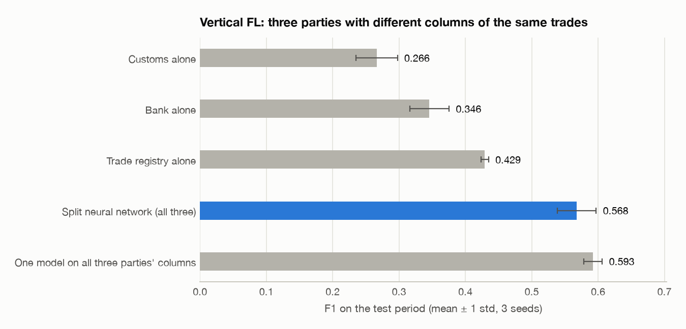

| Model | F1 | PR-AUC |
| --- | ---: | ---: |
| Bank alone | 0.346 ± 0.030 | 0.312 ± 0.033 |
| Trade registry alone | 0.429 ± 0.006 | 0.440 ± 0.006 |
| Customs alone | 0.266 ± 0.031 | 0.212 ± 0.036 |
| Split neural network (all three parties) | 0.568 ± 0.029 | 0.604 ± 0.013 |
| One model on all three parties' columns | 0.593 ± 0.014 | 0.642 ± 0.018 |
| Centralised MLP with all 81 indicators (reference) | 0.753 ± 0.008 | 0.820 ± 0.013 |

Columns per party: bank 23, trade 41, customs 11. Each party sends an 8-dimensional embedding per trade and receives its gradient: 192 bytes per trade per epoch, 6.79 MB per epoch for 35,383 trades, so traffic grows with the data, unlike FedAvg where it grows with the model. Working together beats any party alone, but indicators that compare two parties' fields directly cannot be computed by anyone, which is why this stays below the 81-indicator model. Design note: `docs/fl_design.md`, section 9.

### 9.5 Local fine-tuning of the global model

Reported as a column of the table in section 5.1. It needs no communication and is never much worse than the better of FedAvg and local-only.

## 10. Confusion matrices

Counts on the test period, summed over 3 seeds.

| Method | Data | True positives | False positives | False negatives | True negatives |
| --- | --- | ---: | ---: | ---: | ---: |
| Rules engine | pooled | 923 | 2,050 | 457 | 34,326 |
| Logistic regression | pooled | 876 | 423 | 504 | 35,953 |
| Random forest | pooled | 906 | 238 | 474 | 36,138 |
| LightGBM | pooled | 1,030 | 147 | 350 | 36,229 |
| MLP (centralised) | pooled | 975 | 234 | 405 | 36,142 |
| Local-only | IID, 3 clients | 788 | 244 | 592 | 36,132 |
| Pooled model on local features (diagnostic) | IID, 3 clients | 875 | 250 | 505 | 36,126 |
| FedAvg | IID, 3 clients | 929 | 338 | 451 | 36,038 |
| FedAvg, client thresholds | IID, 3 clients | 903 | 294 | 477 | 36,082 |
| FedAvg + local fine-tuning | IID, 3 clients | 912 | 327 | 468 | 36,049 |
| Local-only | non-IID Dirichlet α=0.5, 3 clients | 958 | 321 | 422 | 36,055 |
| Pooled model on local features (diagnostic) | non-IID Dirichlet α=0.5, 3 clients | 917 | 198 | 463 | 36,178 |
| FedAvg | non-IID Dirichlet α=0.5, 3 clients | 926 | 262 | 454 | 36,114 |
| FedAvg, client thresholds | non-IID Dirichlet α=0.5, 3 clients | 921 | 215 | 459 | 36,161 |
| FedAvg + local fine-tuning | non-IID Dirichlet α=0.5, 3 clients | 959 | 223 | 421 | 36,153 |
| FedProx | non-IID Dirichlet α=0.5, 3 clients | 924 | 296 | 456 | 36,080 |
| Local-only | non-IID Dirichlet α=0.1, 3 clients | 1,027 | 160 | 353 | 36,216 |
| Pooled model on local features (diagnostic) | non-IID Dirichlet α=0.1, 3 clients | 993 | 252 | 387 | 36,124 |
| FedAvg | non-IID Dirichlet α=0.1, 3 clients | 966 | 275 | 414 | 36,101 |
| FedAvg, client thresholds | non-IID Dirichlet α=0.1, 3 clients | 996 | 273 | 384 | 36,103 |
| FedAvg + local fine-tuning | non-IID Dirichlet α=0.1, 3 clients | 1,064 | 204 | 316 | 36,172 |
| FedProx | non-IID Dirichlet α=0.1, 3 clients | 963 | 272 | 417 | 36,104 |

## 11. Limitations

- **Synthetic data.** Entities, prices, routes and all ten typologies come from a simulator. Its difficulty was set by design choices (manipulation
  strength, share of subtle cases, benign noise rates). Absolute numbers would differ on real data, and so might the ranking of methods.
- **Clean, complete labels.** Real labels come from investigations: few, delayed, biased towards what was already suspected.
- **Stationary adversary.** Networks do not adapt to detection. Real launderers do, and a deployed model would drift.
- **Horizontal FL cannot see across institutions.** Patterns that need records of several institutions (duplicate invoices financed at different
  banks, loops across banks) stay invisible. Federated averaging shares parameters, not record linkage.
- **Privacy is partial by default.** Model updates, feature moments and score histograms leak aggregate information. Secure aggregation and DP-SGD
  are demonstrated, not combined, and DP costs accuracy.
- **No defence against a determined poisoner.** Norm clipping bounds one client's influence; it does not detect backdoors.
- **Small scale.** 10 clients at most, one machine, simulated network. Flower's `run_simulation()` is deprecated upstream; the version is pinned.
- **The chain is a single development node.** No consensus, no replication, unlocked development keys, and state that is lost on restart
  (re-anchored from a journal). Latency on it is a lower bound.
- **Integrity is not truth.** A hash proves a record has not changed since it was registered, not that it was true.
- **Three seeds.** Standard deviations over three runs are rough; differences of about 0.01 F1 should not be read as real.
- **Flags, not findings.** Scores and typology suggestions support a human investigator. They are not legal determinations.

## 12. Reproduce

```
make setup      # Python environment and the Hardhat project
make all        # every step, all seeds (about 30 minutes on a laptop CPU)
make quick      # small smoke run
make test       # pytest
```

Per-method metrics: `results/baselines/`, `results/fl/`. Ledger: `results/ledger/`. Alerts: `results/alerts/`. Stretch: `results/stretch/`.
