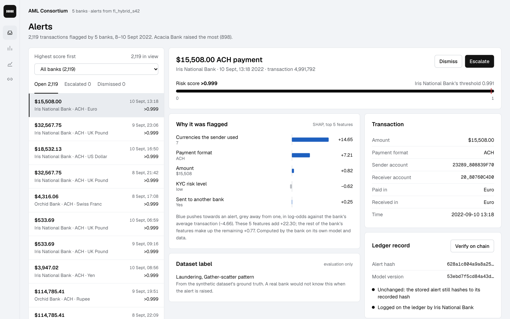
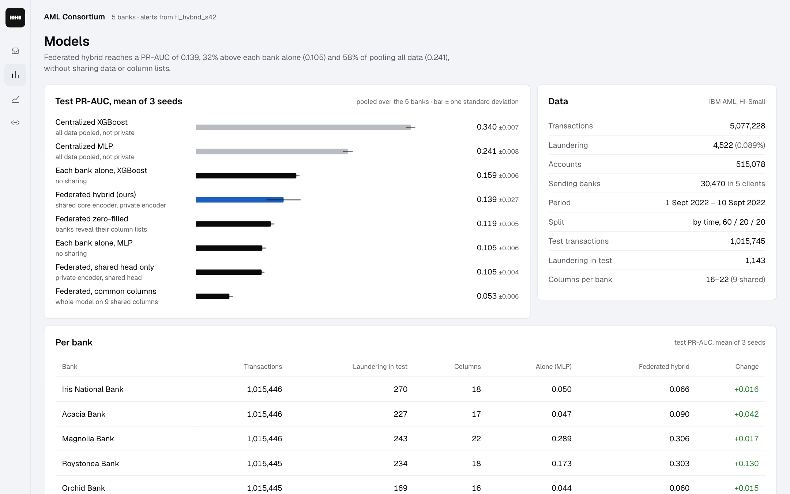
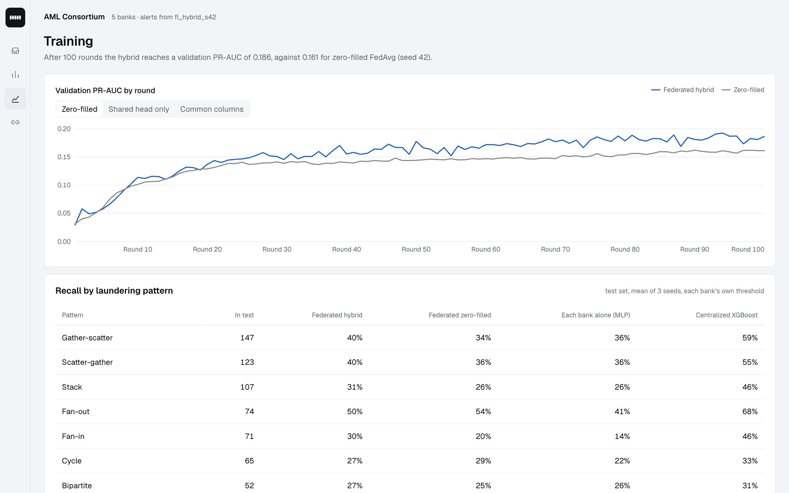
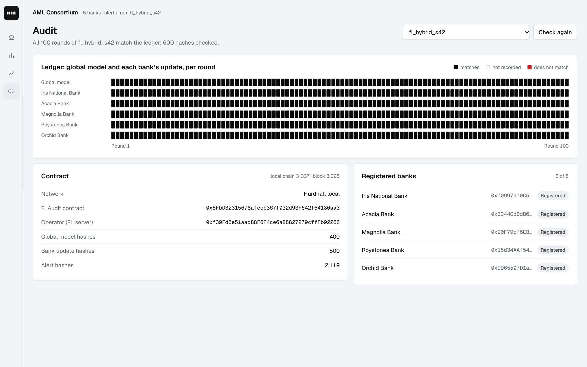

# Dashboard (Phase 5)

A small web app for a compliance analyst in the consortium: FastAPI (`app.py`) serves JSON and a
static front end (`static/`, plain HTML/CSS/JS, no build step, fonts bundled so it works offline).

```bash
python scripts/build_alerts.py fl_hybrid_s42 --chain   # alerts + SHAP, hashes on-chain (node running)
python dashboard/app.py                                 # http://127.0.0.1:8000
```



| View | Question it answers |
|---|---|
| Alerts | Which flagged transactions need review first, and why was each one flagged? Score against the bank's own threshold, the top SHAP features in plain words, the transaction, a live check that the alert is unchanged and was logged on-chain by its bank, and the dataset label (evaluation only). Escalate / Dismiss are kept in the browser only. |
| Models | Does federated training beat each bank alone, and how close does it get to pooling all data? Test PR-AUC of every setup (mean ± std over seeds) and per bank. |
| Training | Validation PR-AUC per round for the hybrid against another setup, and recall per laundering pattern. |
| Audit | Is the model history intact? One cell per round and bank, each a live comparison of `audit.json` with the FLAudit contract. |

Without a chain node every view still works and the ledger checks say they are offline.

| Models | Training | Audit |
|---|---|---|
|  |  |  |

Bank names are display labels set in `configs/default.yaml` (`partition.bank_names`); everywhere
else the banks are `client_0..client_4`. They are fictional (Iris National, Acacia, Magnolia,
Roystonea, Orchid) so that no figure, all of which come from the synthetic IBM AML data, can be read
as a claim about a real bank. Keep any replacement fictional. Remove the setting to go back to
"Bank 0..4".

Design: the "achromatic ledger" app style from the design-taste-frontend skill. The chrome has no
colour; the one hue (#1d5fbf) marks the main data (the explanation bars, the hybrid model); red is
kept for what is wrong. `static/vendor/app.css` and `static/vendor/charts.js` come from that skill.
Fonts: Geist and Geist Mono (SIL Open Font License), Mono only for IDs, addresses and hashes.
